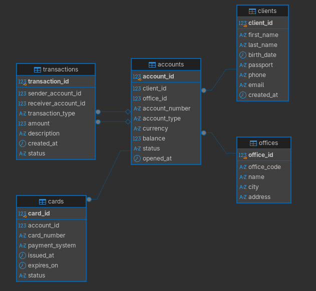

# Лабораторная работа №2

## "Разработка SQL-запросов и аналитических сценариев для реляционной базы данных"

## Вариант 5: Банковская система

### Запустить файл

psql -h localhost -U bank_user -d bank_system -f test.sql